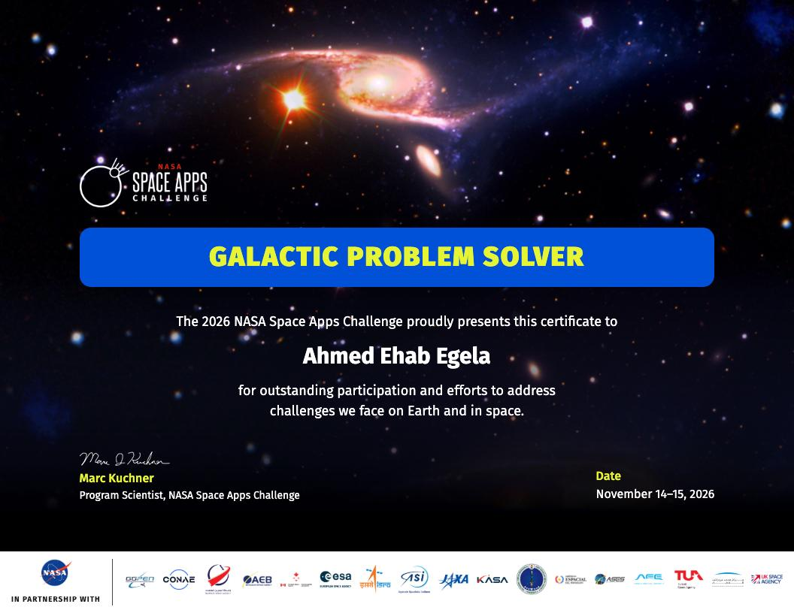

<div align="center">


<p>
  
  
  <a href="https://ahmedehab.dev"></a>
  <a href="https://github.com/alienplus"></a>
</p>

</div>

<br/>

## 🚀 Featured

<div align="center">

<a href="nasa-space-apps/2026-galactic-problem-solver.jpg">

</a>

**Galactic Problem Solver** · NASA Space Apps Challenge 2026
<br/><sub>Awarded for outstanding participation and efforts to address challenges on Earth and in space · 14–15 November 2026</sub>

</div>

<br/>

## 📚 Index

| | Certificate | Issuer | Year | Proof |
| :-: | --- | --- | :-: | :-: |
| 🌌 | **Galactic Problem Solver** (participation) | NASA Space Apps Challenge | 2026 | [View](nasa-space-apps/2026-galactic-problem-solver.jpg) |

<br/>

## 🏆 Related achievement

At the same event I led **Vitalents**, a space-health prototype that won **1st place at NASA Space Apps Giza 2026** and was named a **Global Nominee**.

<p>
  <a href="https://vitalents.life"></a>
  <a href="https://github.com/Vitalents/vitalents_app"></a>
</p>

<br/>

## 📁 Structure

```text
certificates/
├── assets/                 banner
└── nasa-space-apps/        one folder per issuer
    └── 2026-galactic-problem-solver.jpg
```

<sub>New certificates go in a folder per issuer, named `year-title.ext`, then get a row in the index above.</sub>
